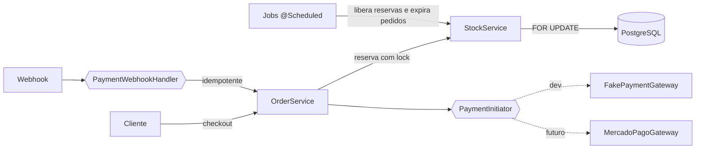

<div align="center">


</div>

<br />

Backend de uma loja online de peças de artesanato pintadas à mão por um único artesão. As peças têm **estoque real**: são produzidas, fotografadas e cadastradas, e o cliente compra o que já existe. Muitas são únicas. Por isso o ponto crítico do sistema é a **concorrência**, para que dois clientes nunca consigam comprar a mesma peça.

### `> destaques técnicos`

| | |
|---|---|
| **Lock pessimista no estoque** | A reserva faz `SELECT ... FOR UPDATE` na linha da peça e só então relê o estoque (lock antes da leitura; a entidade em cache do Hibernate não é confiável aqui). As peças são travadas em ordem de id para evitar deadlock. O segundo comprador espera a transação do primeiro e recebe "peça esgotada" se o estoque zerou. |
| **Reserva com expiração** | O checkout **reserva** o estoque em vez de baixar de vez. Um job `@Scheduled` expira pedidos não pagos (padrão de 20 min) e devolve as peças na mesma transação, com o pedido travado. Pagamento que chega depois da expiração tenta reservar de novo; se a peça esgotou, o pedido vai para `ESTORNO_SOLICITADO`. |
| **Máquina de estados do pedido** | `CARRINHO → AGUARDANDO_PAGAMENTO → PAGO → ENVIADO → ENTREGUE`, com ramos `CANCELADO`/`EXPIRADO` (devolvem estoque) e `ESTORNO_SOLICITADO → ESTORNADO`. |
| **Pagamento desacoplado** | O core conhece só as interfaces `PaymentInitiator` e `PaymentWebhookHandler` (Interface Segregation). O provedor é escolhido por propriedade (`app.payment.provider`). Integrar Mercado Pago ou Stripe é escrever uma nova classe, sem mexer no core. |
| **Webhook idempotente** | O `transaction_id` do gateway é `UNIQUE` e um pagamento já resolvido é ignorado. Um webhook repetido nunca marca o pedido como pago duas vezes. |
| **Frete plugável** | `ShippingProvider` com implementação fake para dev, no mesmo modelo do pagamento. |
| **Kits sem estoque próprio** | O estoque de um conjunto é calculado na hora como o **mínimo** entre as peças que o compõem. A peça é a única fonte de verdade. |
| **Auth completa** | Signup e login com JWT, **refresh token com rotação** (cada uso revoga o anterior), logout e perfis `CLIENTE` / `ADMIN`. |
| **Backoffice** | Ajuste manual de estoque com trilha (`stock_adjustments`), gestão de pedidos e relatórios de vendas por período, peças mais vendidas e pedidos pendentes de envio. |

### `> arquitetura`

**Monólito modular** organizado por domínio, não por camada técnica. Cada módulo pode ser extraído como serviço no futuro sem reescrita.

```
com.TadeuArtesanatos.demo
├── security/   auth, JWT, refresh token, filtro
├── user/       usuários e perfis
├── customer/   cliente e endereços
├── catalog/    peças, conjuntos (kits), categorias, imagens
├── stock/      reserva com lock, expiração, ajustes manuais
├── order/      pedido, itens, máquina de estados, job de expiração
├── payment/    PaymentInitiator · PaymentWebhookHandler · fake gateway
├── shipping/   ShippingProvider · fake provider
├── admin/      endpoints e relatórios de backoffice (sem entidade própria)
└── common/     exceções globais
```

Cada domínio segue `entity / mapper (MapStruct) / repository / service / controller / dto`.



### `> endpoints`

Documentação completa no Swagger: **http://localhost:8080/swagger-ui.html**

<details>
<summary><b>Autenticação</b> · <code>/auth</code></summary>

`POST /auth/signup` · `POST /auth/login` · `POST /auth/refresh` · `POST /auth/logout`

</details>

<details>
<summary><b>Catálogo</b> · leitura pública, escrita ADMIN</summary>

| Recurso | Rotas |
|---|---|
| Peças | `GET/POST /api/catalog/pieces` · `GET/PUT/DELETE /api/catalog/pieces/{id}` (DELETE = soft delete) |
| Conjuntos | `GET/POST /api/catalog/sets` · `GET/PUT/DELETE /api/catalog/sets/{id}` |
| Categorias | `GET/POST /api/catalog/categories` · `DELETE /api/catalog/categories/{id}` |

</details>

<details>
<summary><b>Cliente</b> · autenticado</summary>

| Rotas | Descrição |
|---|---|
| `POST/GET/PUT/DELETE /api/customers/me` | perfil do cliente |
| `POST/GET /api/customers/me/addresses` · `DELETE …/{addressId}` | endereços |

</details>

<details>
<summary><b>Pedido, frete e pagamento</b> · cliente autenticado</summary>

| Rotas | Descrição |
|---|---|
| `POST /api/orders/me` | abre o carrinho |
| `POST /api/orders/me/items` · `PUT/DELETE …/items/{itemId}` | itens do carrinho |
| `GET /api/orders/me/{orderId}/shipping/quotes` · `POST …/shipping` | cotação e escolha de frete |
| `POST /api/orders/me/checkout` | reserva o estoque → `AGUARDANDO_PAGAMENTO` |
| `POST/GET /api/orders/me/{orderId}/payments` | inicia ou consulta pagamento |
| `POST /api/orders/me/{orderId}/cancel` | cancela e devolve estoque |
| `POST /api/orders/me/{orderId}/refund-request` | solicita estorno |
| `GET /api/orders/me` · `GET /api/orders/me/{orderId}` | meus pedidos |

</details>

<details>
<summary><b>Backoffice</b> · ADMIN</summary>

| Rotas | Descrição |
|---|---|
| `GET /api/orders` · `GET /api/orders/{id}` | todos os pedidos |
| `POST /api/orders/{id}/mark-paid` · `ship` · `deliver` · `cancel` | transições manuais (ship recebe código de rastreio) |
| `POST /api/orders/{id}/refund-approve` · `refund-deny` | decisão de estorno |
| `POST /api/admin/pieces/{id}/stock-adjustment` | ajuste manual de estoque (ex: venda fora do site) |
| `GET /api/admin/orders/{id}` | detalhe completo do pedido |
| `GET /api/admin/reports/sales` · `best-selling-pieces` · `pending-shipment` | relatórios |
| `/api/stock/reservations/**` · `/api/users/**` | reservas e usuários |
| `POST /api/payments/webhook/fake` | simula o retorno assíncrono do gateway (público só em dev; nos outros profiles exige ADMIN e o pagamento fica `PENDING` até ser confirmado aqui) |

</details>

### `> como rodar`

Requisitos: **Java 21** e **Docker**.

```bash
git clone https://github.com/cm0420/EvendasArtesanato.git
cd EvendasArtesanato
cp .env.example .env
./mvnw spring-boot:run
```

No profile `dev`, o **Spring Boot Docker Compose Support** sobe o Postgres pelo `compose.yaml` e o Flyway aplica as 19 migrations. Os gateways de pagamento e frete usam as implementações fake.

**Simulando o ambiente de produção** (imagem multi-stage com JRE enxuta e Postgres com volume):

```bash
docker compose -f docker-compose.local.yml up --build
```

| Variável | Descrição |
|---|---|
| `SPRING_PROFILES_ACTIVE` | `dev`, `docker` ou `prod` |
| `DB_HOST` · `DB_PORT` · `DB_NAME` · `DB_USERNAME` · `DB_PASSWORD` | conexão com o Postgres |
| `JWT_SECRET` | obrigatória fora de `dev` |

Segredos vêm sempre de variáveis de ambiente. Nada fica fixo no `application.yml`.

### `> roadmap`

- [x] Domínios, migrations, auth com refresh token
- [x] Reserva de estoque com lock pessimista e expiração
- [x] Máquina de estados do pedido, estorno e backoffice
- [x] Abstração de pagamento e frete com implementações fake e webhook idempotente
- [x] **Teste de concorrência com Testcontainers**: várias threads comprando a mesma peça única, e só uma pode conseguir (`OrderConcurrencyTests`)
- [ ] Testes de integração por módulo
- [ ] Integração real com gateway de pagamento e com cotação de frete dos Correios
- [ ] Front-end da loja e do painel (Angular, em desenvolvimento)

<div align="center">
<br />
<sub>Desenvolvido por <a href="https://github.com/cm0420">Miguel Costa</a></sub>
</div>
